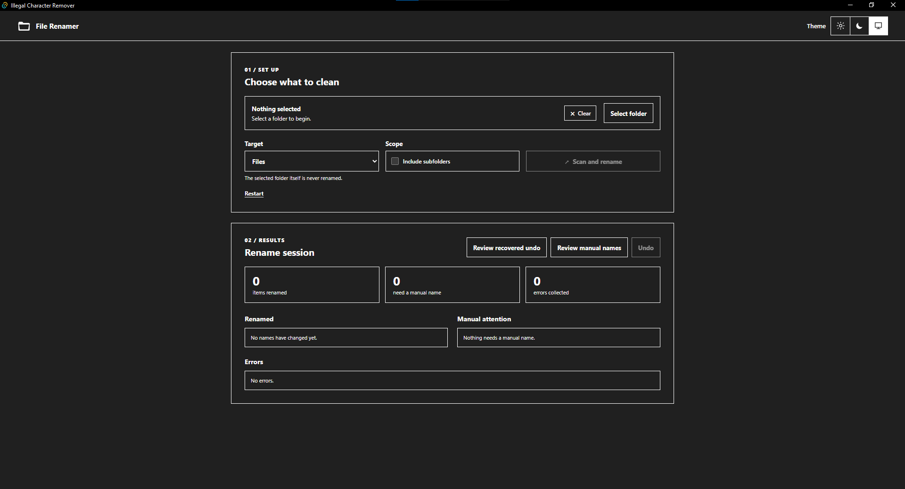

# Illegal Character Remover

A Windows desktop app that renames files and folders to remove characters
that can cause problems when compressing them. Characters outside
`A-Z`, `a-z`, and `0-9` are replaced with spaces. It is built for cleaning
downloaded media and datasets before zipping them.

> **[Download for Windows — latest NSIS installer](https://github.com/SanjidArefin/Illegal_character_remover/releases/latest)**



- **GUI:** Tauri v2 with vanilla HTML, CSS, and JavaScript
- **Backend:** Python sidecar bundled as a single `.exe` with PyInstaller
- **Installer:** NSIS `.exe`, distributed through GitHub Releases

## What It Does

- Replaces every non-alphanumeric character in a filename or folder name with
  a space, then trims leading and trailing spaces.
- Preserves a file's last extension.
- Adds `(1)`, `(2)`, and so on when a cleaned name conflicts with an existing
  name.
- Flags names that become empty after cleaning for manual rename.
- Keeps an undo log so renames can be reversed.
- Never renames the selected root folder.
- Processes recursive operations deepest-first so parent renames do not
  invalidate child paths.

### Modes

The GUI uses **Target** and **Scope** controls:

| Target | Scope off | Scope on |
| --- | --- | --- |
| Files | `files_non_recursive` | `files_recursive` |
| Folders | Always recursive | `folders_recursive` |
| Files + Folders | `files_and_folders_non_recursive` | `files_and_folders_recursive` |

- **Scope off** processes only the selected folder's direct children.
- **Scope on** processes everything below it, recursively.
- Folders are always processed recursively. Choosing **Folders** checks and
  disables the scope toggle.

## Project Layout

```text
Illegal_character_remover/
├── backend/                      # Python sidecar
│   ├── __init__.py
│   ├── main.py                   # JSON-lines stdin/stdout entry point
│   ├── rename_logic.py           # Scan, rename, and undo logic
│   └── build.py                  # PyInstaller wrapper
├── src/                          # Vanilla frontend
│   ├── index.html
│   ├── styles.css
│   ├── main.js                   # UI and sidecar protocol client
│   └── manual-validation.js      # Manual rename validation
├── src-tauri/                    # Tauri v2 shell
│   ├── src/
│   │   ├── lib.rs
│   │   └── main.rs
│   ├── capabilities/default.json
│   ├── binaries/                 # Target-named sidecar executable
│   ├── Cargo.toml
│   └── tauri.conf.json
├── package.json
├── pnpm-lock.yaml
├── vite.config.js
└── README.md
```

## Building From Source

### Prerequisites

- Node.js LTS and pnpm
- Rust with the MSVC toolchain
- Microsoft C++ Build Tools with **Desktop development with C++**
- Microsoft Edge WebView2 Runtime (normally included on Windows 10 version
  1803 and later, and Windows 11)
- Python 3.11 or later with PyInstaller

See Tauri's [Windows prerequisites](https://v2.tauri.app/start/prerequisites/)
for the C++ Build Tools, WebView2, and Rust setup.

### Build

From PowerShell in the project directory:

```powershell
pnpm install

# Build the Python sidecar into src-tauri/binaries/
python backend/build.py

# Run the desktop app in development
pnpm tauri dev

# Build a production installer
pnpm tauri build
```

`backend/build.py` uses the current Rust host triple in the sidecar filename,
for example `illegal-char-remover-x86_64-pc-windows-msvc.exe`. This matches
the `bundle.externalBin` setting in `src-tauri/tauri.conf.json`. Build the
sidecar before building or running the desktop app.

The NSIS installer is created under:

```text
src-tauri/target/release/bundle/nsis/
```

The current version is `0.1.1`. Before a new release build, update the version
in `package.json`, `src-tauri/tauri.conf.json`, and `src-tauri/Cargo.toml`.
Windows treats installs with the same app identifier as upgrades, so an
existing version does not need to be uninstalled first.

## Using the App

1. Click **Select folder**. The selected folder itself is never renamed.
2. Choose a **Target** and **Scope**.
3. Click **Scan and rename**. The progress bar shows live scan counts and
   rename progress.
4. Review the results: renamed count, errors, and items needing manual names.
   **Review manual names** opens a one-at-a-time dialog. Names may contain only
   `A-Z`, `a-z`, `0-9`, and spaces. File extensions are preserved. Duplicate
   names, including names already used in the same session, are rejected.
5. Click **Undo** to reverse the current session's renames immediately.
   Entries are persisted in `%APPDATA%\illegal-char-remover\undo.jsonl`.
   If the app finds entries from a previous session, it asks before undoing
   them. Dismissing the prompt leaves them available through **Review recovered
   undo**. Starting a new rename batch drops previous-session recovery history.

The **Theme** selector offers **Light**, **Dark**, and **System**; **System** is
the default. Renaming is performed locally on the device.

## Troubleshooting

### Python sidecar stopped or could not start

1. Click **Restart** in the app to start the Python sidecar again.
2. If it stops again, close and reopen the app. If the problem persists, get
   the latest installer from [GitHub Releases](https://github.com/SanjidArefin/Illegal_character_remover/releases/latest)
   and reinstall it.
3. When running from source, rebuild the sidecar before starting or packaging
   the app:

   ```powershell
   python backend/build.py
   pnpm tauri dev
   # Or create a production installer:
   pnpm tauri build
   ```

The sidecar executable must be present in `src-tauri/binaries/` with the name
matching your Rust target triple. `backend/build.py` creates the correctly
named executable for the current machine.

## Tests

```powershell
python -m unittest discover -s tests -p 'test_*.py'
pnpm test:frontend
pnpm build
```

The backend tests use a synthetic tree with more than 1,800 files and cover the
rename modes, manual-name conflicts, and mixed-batch undo.

## Legacy CLI

`Illegal_character_remover.py` remains available as a legacy command-line
wrapper. It supports explicit file paths, a non-recursive `--folder` run, and
the original interactive entry point:

```powershell
python Illegal_character_remover.py --folder "D:\data\files"
python Illegal_character_remover.py "D:\data\file1.txt" "D:\data\file2.pdf.txt"
python Illegal_character_remover.py
```

The desktop app is the supported interface for recursive folder modes, manual
review, and undo.
